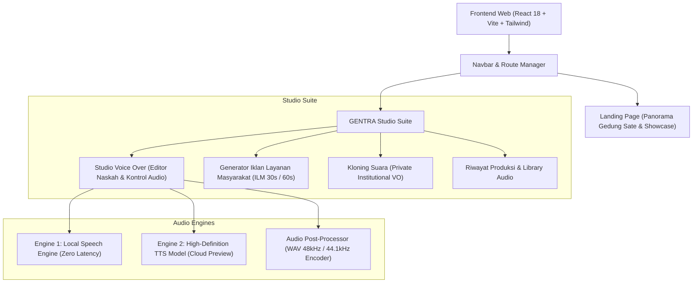

# GENTRA — Generator Voice Over Natural 🎙️

[](https://gentra.kitt.lt)
[](#)
[](https://github.com/bangkitberuang)
[](https://jabarprov.go.id)
[](#standar-audio-broadcast)
[](#)

> **"Ti Téks Jadi Sora."**  
> Platform sintesis suara natural berstandar studio rekaman dan penyiaran untuk **Tim Komunikasi Publik Dinas Komunikasi dan Informatika Provinsi Jawa Barat (Diskominfo Jabar)**.

---

## 📌 Ringkasan Proyek

**GENTRA** menghadirkan solusi produksi audio publik yang efisien, merdu, dan berakar kuat pada kearifan lokal Jawa Barat. Dibangun khusus untuk memproduksi materi audio informasi publik, video edukasi, podcast kedinasan, dan Iklan Layanan Masyarakat (ILM) secara instan tanpa mengorbankan kehangatan intonasi manusia.

### 🌟 Keunggulan Utama
1. **22 Karakter Vokal Khas (14 Nasional + 8 Sunda Orisinal)**: Meliputi intonasi formal pembaca berita, narator dokumenter, hingga celetukan akrab khas Sunda (Kang Cecep, Ceu Edah, Budak Leutik, Ki Lengser).
2. **Generator Naskah ILM Otomatis**: Menghasilkan naskah kampanye 30 detik & 60 detik berbasis topik strategis (Stunting, Sampah/Kebersihan, Pangan, Pajak Daerah, Pajagalan Digital).
3. **Standar Broadcast Audio**: Engine mastering audio WAV 48.000 Hz (standar video/TV broadcast) dan 44.100 Hz (standar podcast/streaming audio).
4. **Dual Engine Voice Synthesis**: Menggabungkan performa lokal instan (*Zero-Latency Web Speech API*) dengan kedalaman ekspresi *Cloud High-Fidelity TTS Model*.
5. **Whisper Transcription & Naskah**: Kemampuan mentranskripsi rekaman suara mentah menjadi naskah tertulis siap produksi.

---

## 🎭 Katalog 22 Persona Suara

### 🍃 Karakter Khas Sunda (8 Karakter)
| No | Persona | Gender | Karakteristik Vokal | Contoh Kalimat Pembuka |
|:---:|:---|:---:|:---|:---|
| 1 | **Kang Cecep** | Pria | Ceria, lincah, gaul nyunda, energik | *"Sampurasun wargi Jabar! Hayu urang babarengan ngamumule Jawa Barat Juara!"* |
| 2 | **Ceu Edah (Bibi)** | Wanita | Heboh, akrab, guyub, medok renyah bersahabat | *"Aduh euy wargi sadayana, tong hilap jaga kaberesihan sareng kasehatan lingkungan nya!"* |
| 3 | **Budak Leutik Eneng** | Wanita | Imut, polos, cempreng alami, menggemaskan | *"Bapa, Ibu... Eneng hoyong diajar maca Al-Qur'an sareng ngadongeng sasarengan!"* |
| 4 | **Budak Leutik Ujang** | Pria | Lincah, polos, suka bertanya, periang | *"Horeee! Hayu urang ulin ka buruan bari diajar elmu pangaweruh anyar!"* |
| 5 | **Teh Neng** | Wanita | Lembut, santun, tutur kata merdu khas Mojang Priangan | *"Wilujeng sumping di tatar Parahyangan, nagri asri pinuh ku katengtreman."* |
| 6 | **Mang Udin** | Pria | Wibawa kampung, ramah, artikulatif | *"Haturan sadayana, mangga urang sasarengan ngarojong program pangwangunan desa."* |
| 7 | **Ki Lengser** | Pria | Sepuh, bijak, tenang, penuh pitutur luhur | *"Regepkeun anaking jimat awaking, titipan karuhun kedah dijaga kalayan asih."* |
| 8 | **Ambu Asih** | Wanita | Keibuan, teduh, penuh welas asih dan nasehat | *"Ulah hariwang hidep kasep geulis, sabar tawekal mayunan cocooan hirup."* |

### 🇮🇩 Karakter Nasional & Penyiaran (14 Karakter)
- **Anita** (Ramah & Ceria) • **Siti** (Lembut & Santun) • **Agus** (Deep & Naratif)
- **Dewi** (Energik & Lugas) • **Tina** (Profesional Berita) • **Maya** (Inspiratif & Hangat)
- **Rian** (Muda & Dinamis) • **Indah** (Halus & Menenangkan) • **Gading** (Berat & Maskulin)
- **Shinta** (Tegas & Berani) • **Bayu** (Santai & Sejuk) • **Adi** (Ceria & Cepat)
- **Kusuma** (Naratif Klasik) • **Budi** (Santai & Bersahabat)

---

## 🛠️ Arsitektur Teknologi



---

## 🚀 Panduan Memulai (Quickstart)

### Prasyarat
- Node.js versi 18 atau lebih baru
- NPM atau PNPM

### Instalasi
```bash
# Clone repositori
git clone https://github.com/bangkitberuang/gentra.git
cd gentra

# Install dependensi
npm install
```

### Konfigurasi Environment (Opsional)
Buat file `.env` di root project jika ingin menggunakan Cloud TTS Engine:
```env
VITE_GEMINI_API_KEY=your_gemini_api_key_here
```
> *Catatan: Jika API Key tidak disematkan, GENTRA secara otomatis menggunakan Local Speech Engine bawaan peramban dengan 22 pemetaan frekuensi dan intonasi.*

### Menjalankan Development Server
```bash
npm run dev -- --port 3000
```
Buka browser pada: `http://localhost:3000/`

### Build untuk Produksi
```bash
npm run build
```
File siap saji akan dibuat di folder `dist/` dan siap di-deploy ke Web Server / Cloud CDN.

### ☁️ Deployment Online ke Vercel (1-Click Ready)
Proyek ini sudah dikonfigurasi penuh dengan **Vercel Serverless Functions** (`vercel.json` dan folder `api/`).
1. Buka [vercel.com](https://vercel.com) dan masuk dengan akun GitHub Anda.
2. Klik **Add New Project** -> **Import Repository** -> pilih `gentra`.
3. Di bagian **Environment Variables**, tambahkan (opsional untuk Cloud AI):
   - `GEMINI_API_KEY` (atau `VITE_GEMINI_API_KEY`)
   - `ELEVENLABS_API_KEY` (jika menggunakan ElevenLabs)
   - `AZURE_SPEECH_KEY` & `AZURE_SPEECH_REGION` (jika menggunakan Azure)
4. Klik **Deploy**. Web langsung aktif dengan domain HTTPS gratis!

> 📘 **Catatan Arsitektur:** Logika backend di folder `server/` kini memiliki adapter Serverless di folder `api/tts/` agar dapat berjalan otomatis di cloud Vercel. Rincian perubahan lengkap dapat dibaca pada [**CHANGELOG.md**](./CHANGELOG.md).


---

## 📋 SOP Alur Kerja Produksi Voice Over

1. **Pemilihan Topik / Naskah**:
   - Untuk iklan cepat, gunakan **Mode ILM** untuk membuat draf naskah 30 atau 60 detik.
   - Untuk rilis pers atau berita video, masukkan teks langsung di **Studio Voice Over**.
2. **Pemilihan Karakter & Bahasa**:
   - Pilih persona yang sesuai target audiens (gunakan persona Sunda untuk konten kultural/lokal dan persona Nasional untuk pengumuman resmi).
3. **Pengaturan Tempo & Nada**:
   - Sesuaikan Pitch dan Speed pada panel kontrol sesuai durasi video.
4. **Pratinjau & Mastering**:
   - Dengarkan pratinjau audio.
   - Pilih resolusi ekspor (48 kHz untuk video editor / 44.1 kHz untuk podcast).
5. **Ekspor & Dokumentasi**:
   - Unduh file WAV master ke penyimpanan lokal produksi.

---

## 🏛️ Hak Cipta & Ekosistem

© 2026 **GENTRA** • **BANGKIT Beruang Ecosystem**  
Didedikasikan untuk **Bidang Informasi & Komunikasi Publik (IKP), Dinas Komunikasi dan Informatika Provinsi Jawa Barat**.
