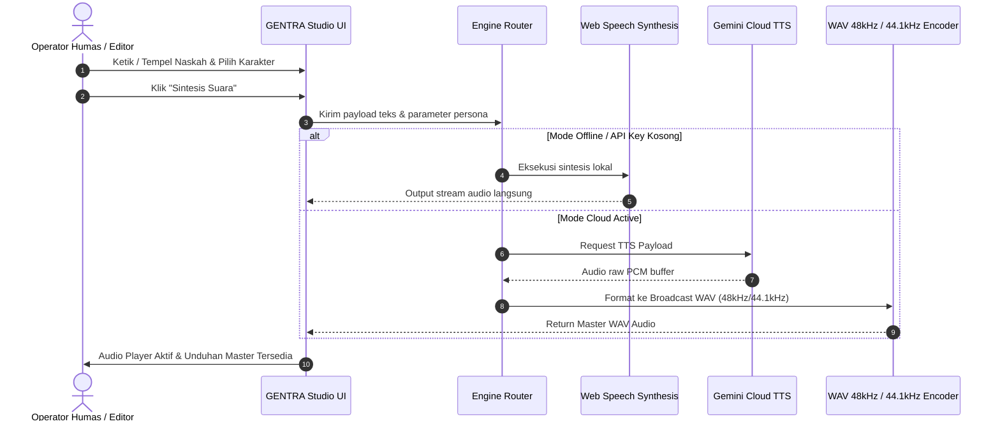

# Arsitektur Teknis GENTRA

## 1. Komponen Utama

Sistem GENTRA terdiri atas tiga lapisan arsitektur:

### A. Lapisan Antarmuka (Presentation Layer)
- **Landing Page (`LandingPage.jsx`)**: Menampilkan showcase produk, filosofi, panorama visual Gedung Sate Parahyangan, bagan interaktif ekosistem penyiaran, serta 22 audio player demo untuk masing-masing persona vokal.
- **Studio Interface (`GentraStudio.jsx`)**: Ruang kerja terpadu penyintesis audio dengan 4 navigasi utama:
  1. **Studio**: Editor teks, selector persona 3D kartu taktil, kontrol frekuensi/pitch, audio visualizer live equalizer, dan tombol mastering.
  2. **Iklan Layanan Masyarakat (ILM)**: Template generator naskah 30 detik & 60 detik berbasis topik strategis Jabar.
  3. **Kloning Suara**: Modul pengenalan vokal instansi internal dengan keamanan biometrik.
  4. **Riwayat**: Repositori arsip audio hasil produksi dan manajemen unduhan WAV.

### B. Lapisan Sintesis Audio (Synthesis & DSP Engine)
- **Local Web Speech Synthesis Engine**:
  - Dijalankan langsung pada klien peramban (zero latency, zero server cost).
  - Dipetakan secara akurat dengan tuning pitch (0.7 hingga 1.35) dan rate kecepatan (0.8 hingga 1.25) untuk merepresentasikan 22 kepribadian suara.
- **Cloud High-Definition TTS Model**:
  - Memanfaatkan model mutakhir dengan model identifier `gemini-2.5-flash-preview-tts`.
  - Menghasilkan respon audio beresolusi tinggi dengan kedalaman nafas dan artikulasi kata bahasa daerah yang kaya.
- **Mastering & WAV Encoding Unit**:
  - Melakukan konversi format output audio ke standar industri penyiaran (Broadcast WAV) dengan sampling rate 48.000 Hz (untuk sinkronisasi video editor) dan 44.100 Hz (untuk transmisi radio & streaming).

---

## 2. Diagram Alur Data Sintesis

---

## 3. Keamanan & Kepatuhan Data

- **Biometrik & Suara Pimpinan**: Modul Kloning Suara dirancang hanya dapat diakses melalui verifikasi PIN internal kedinasan untuk mencegah penyalahgunaan deepfake audio pejabat publik.
- **Penyimpanan Lokal**: Naskah dan riwayat audio disimpan dalam local storage dan memory browser pengguna sehingga kerahasiaan draf siaran pers tetap terjaga sebelum waktu rilis resmi.
